<div align="center">


# 🔬 ForenSight
### Advanced Digital Forensics & Evidence Intelligence Platform

[](https://github.com/parthkamble4536-ship/ForenSight/actions/workflows/ci.yml)
[](https://python.org)
[](https://fastapi.tiangolo.com)
[](Dockerfile)
[](tests/)
[](#security)
[](LICENSE)
[](#security)

<br/>

> **A high-assurance, air-gapped, local-first forensic workbench** for incident responders, DFIR analysts, students, and security engineers — no cloud, no execution, no leakage.

<br/>

**[🚀 Quick Start](#-quick-start) · [🖥️ Screenshots](#-screenshots) · [🏗️ Architecture](#-architecture) · [🔬 Analyzers](#-forensic-analyzers) · [🔐 Security](#-security-model) · [🐳 Docker](#-docker) · [🧪 Tests](#-testing)**

</div>

---

## ✨ What is ForenSight?

**ForenSight** is a production-grade, **static-only** digital forensics platform built for SOC analysts, malware researchers, forensic examiners, and cybersecurity students.

It allows you to:
- **Upload** any suspect file — PE executables, PDFs, Office documents, emails, archives, images, logs.
- **Identify** real file type via binary magic bytes, catching masquerading attacks.
- **Analyze** deeply using 7 format-specific forensic analyzers with MITRE ATT&CK mapping.
- **Score** threat level 0–100 with fully explainable, deterministic risk rules.
- **Extract** defanged IOCs (IPs, URLs, hashes, registry keys, paths).
- **Track** every action via a tamper-evident SHA-256 hash-chained Chain of Custody ledger.
- **Verify** integrity with Ed25519 digital signatures at any time.
- **Export** signed forensic reports in HTML, JSON, PDF, CSV (findings), and STIX 2.1 (threat intel).

> **🔒 Zero-Execution Guarantee**: ForenSight never executes, loads, or evaluates uploaded evidence. No `subprocess`, no `eval`, no shell — verified by automated AST scanning in every CI run.

---

## 🖥️ Screenshots

### 1. Evidence Triage Workbench — Explainable Risk Verdict
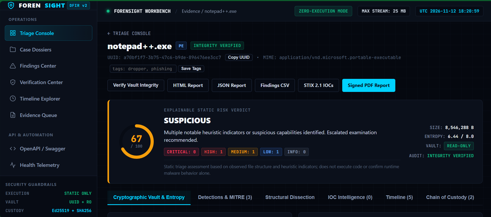

### 2. Cryptographic Vault & Ed25519 Signed Manifest
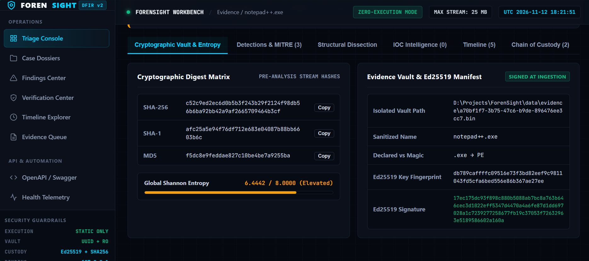

### 3. Detections & MITRE ATT&CK Mapping
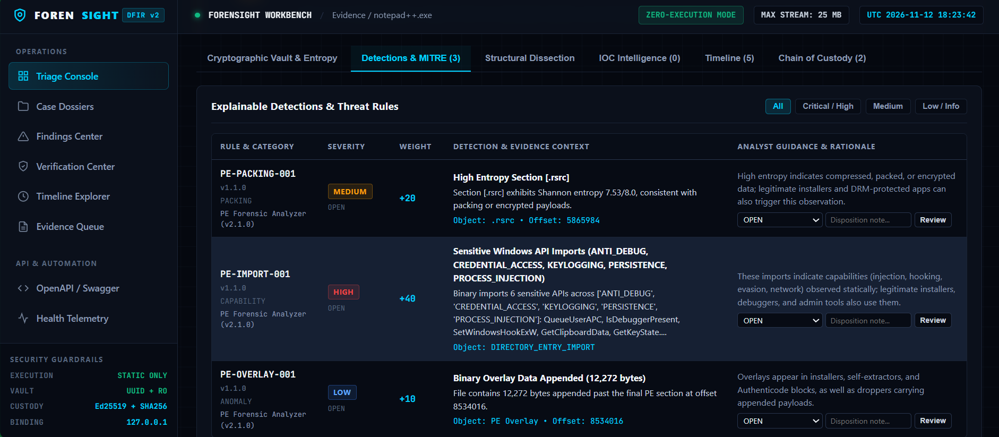

### 4. Forensic Timeline — UTC Normalized Events
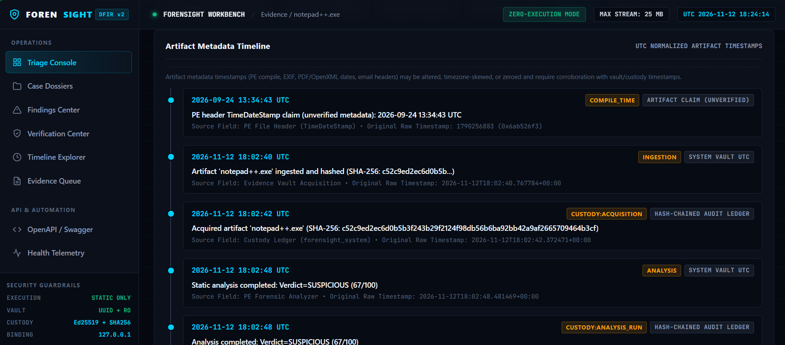

### 5. Chain of Custody — SHA-256 Hash-Chained Ledger
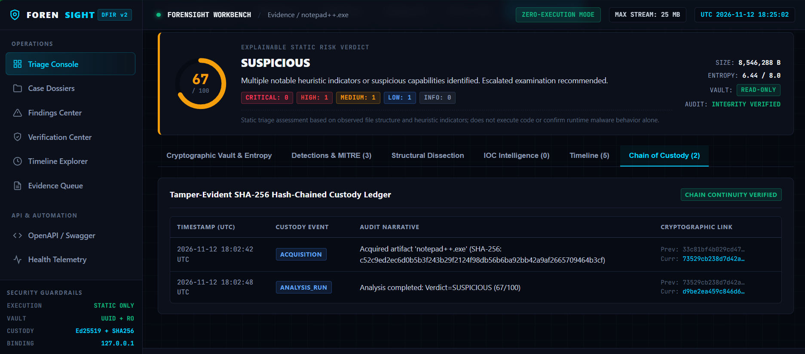

### 6. Standalone Forensic Report (HTML Export)
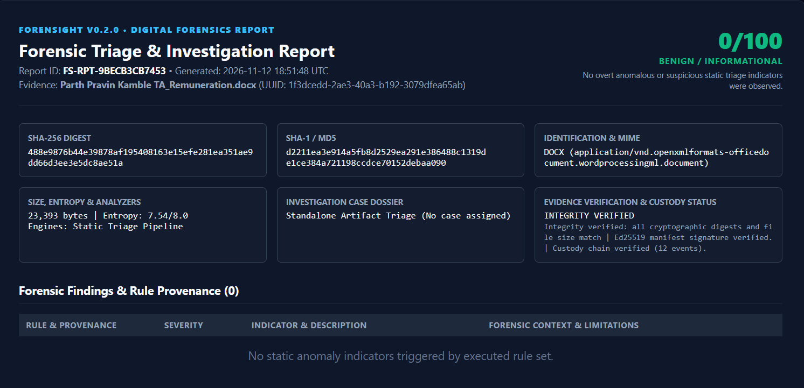

### 7. EML Evidence Verification — Integrity Pass
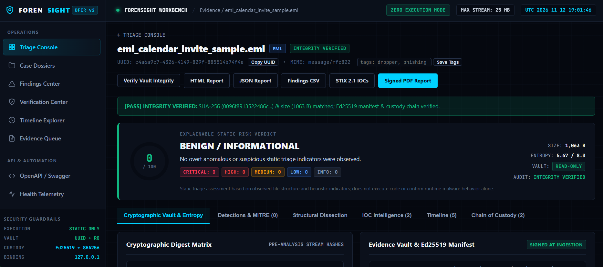

---

## 🏗️ Architecture

### System Overview

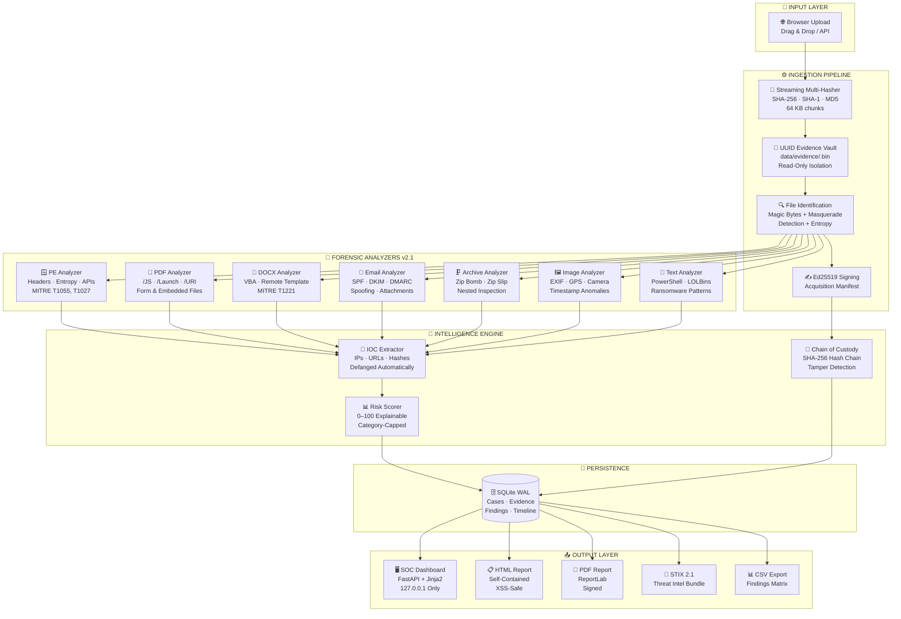

---

### Security Boundaries

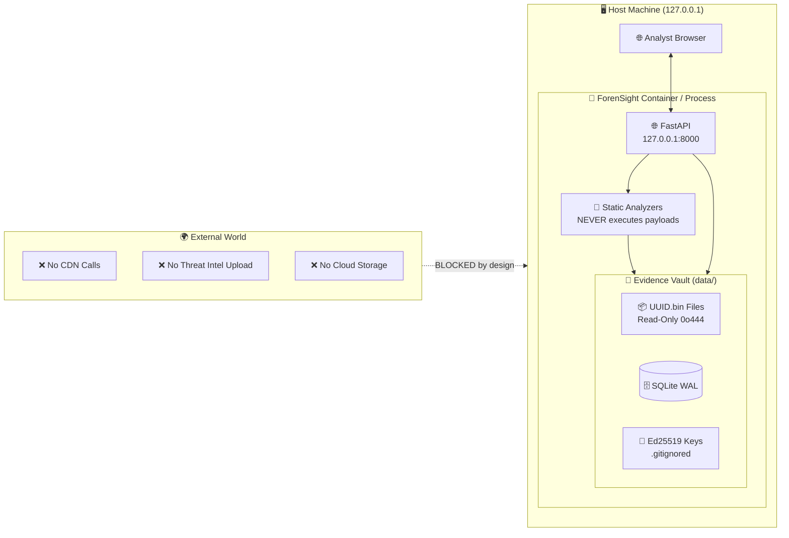

---

### Database Entity Relationship

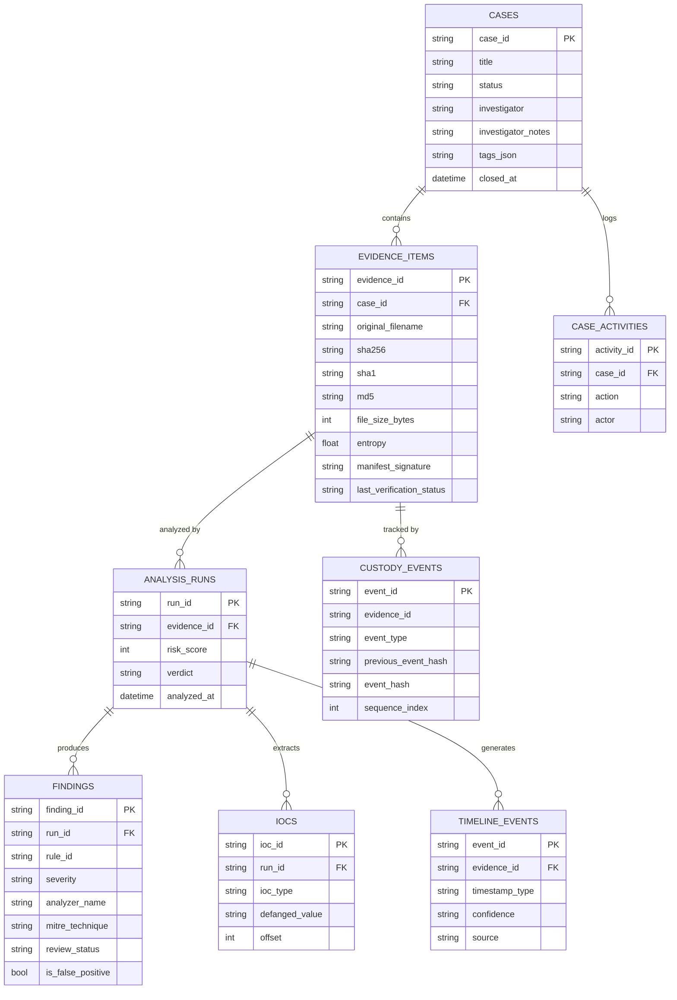

---

### CI/CD Pipeline

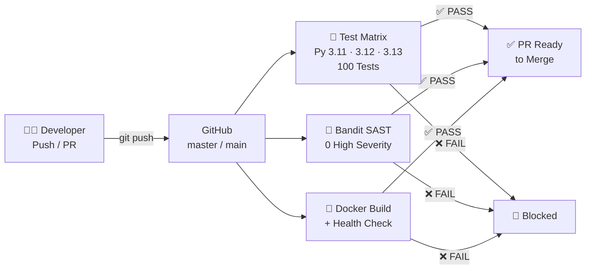

---

## 🔬 Forensic Analyzers

| Analyzer | File Types | Key Detections | MITRE ATT&CK |
|:---|:---|:---|:---|
| **PE Analyzer v2.1** | `.exe`, `.dll`, `.sys` | PE32/PE32+ headers, compile timestamp, section entropy, RWX sections, IAT suspicious APIs, exports, PDB paths, overlay | T1027 (Obfuscation), T1055 (Process Injection), T1056 (Keylogging) |
| **PDF Analyzer v2.1** | `.pdf` | `/JavaScript`, `/Launch`, `/OpenAction`, `/EmbeddedFiles`, `/AcroForm`, `/URI` IOCs | T1566 (Phishing), T1204 (User Execution) |
| **Office Analyzer v2.1** | `.docx`, `.docm` | VBA macro storage, OLE objects, External Template Injection (`.dotm`), bounded XML parsing | T1221 (Template Injection), T1137 (Office Application Startup) |
| **Email Analyzer v2.1** | `.eml` | Header spoofing, SPF/DKIM/DMARC, `Return-Path` anomalies, dangerous attachments | T1566.001 (Spearphishing Attachment), T1598 (Phishing for Info) |
| **Archive Analyzer v2.1** | `.zip` | Zip Slip traversal, zip bombs (ratio/size/entries), nested inspection, double extensions | T1027 (Obfuscation), T1074 (Data Staged) |
| **Image Analyzer v2.1** | `.jpg`, `.png`, `.gif` | EXIF metadata, GPS coordinates, camera fingerprinting, editing software (Photoshop/GIMP) | T1646 (Exfiltration over C2) |
| **Text/Log Analyzer v2.1** | `.txt`, `.log`, `.csv`, `.xml` | PowerShell encoding, `IEX`/`iex`, `vssadmin`, `certutil`, `mimikatz`, LOLBins | T1059 (Command Interpreter), T1490 (Shadow Copy Deletion) |

---

## 🧪 Testing

The project maintains **100 automated test cases** across 25 test suites:

```bash
python -m pytest tests/ -v
```

| Test Module | Coverage Area |
|:---|:---|
| `test_phase1_fixes.py` | SQLite persistence, custody chain, HTML escaping, timeline |
| `test_phase2_analyzers.py` | All 7 analyzers, detection provenance, bounded parsing |
| `test_phase3_intelligence.py` | Verification Center, Findings, Timeline, Case Workflow |
| `test_phase4_5_validation.py` | Adversarial inputs, Zip Slip, bombs, AST security guard |
| `test_pe_analyzer.py` | PE header parsing, entropy, IAT analysis |
| `test_pdf_analyzer.py` | PDF action detection, encryption |
| `test_email_analyzer.py` | Spoofing detection, header anomalies |
| `test_crypto.py` | Ed25519 key generation, signing, verification |
| `test_custody_ledger.py` | Chain integrity, tamper detection |
| `test_storage_security.py` | Zip Slip defense, path traversal |
| *(+ 15 more modules)* | Hashing, strings, IOC extraction, scoring, database, API |

---

## 🔐 Security Model

| Guardrail | Implementation |
|:---|:---|
| **Zero Execution** | AST-verified: `0` calls to `subprocess`, `os.system`, `eval`, or `exec` |
| **Localhost Only** | Binds to `127.0.0.1:8000` by default — not accessible from network |
| **XSS Prevention** | All report output HTML-escaped with `html.escape(quote=True)` |
| **Zip Bomb Defense** | 100 MB expansion cap, 100.0x ratio limit, 500 entry ceiling, depth 2 |
| **Path Traversal** | Zip Slip guard on archive members; `sanitize_filename()` on all uploads |
| **XXE Prevention** | XML member reads capped at 2 MB with DTD/ENTITY tag screening |
| **Evidence Isolation** | UUID4-named `.bin` files outside web-served routes, read-only permissions |
| **Chain of Custody** | SHA-256 hash chain with `sequence_index`; refuses tampered DB append |
| **Cryptographic Signing** | Ed25519 manifest signed at acquisition; verifiable at any time |
| **External Intel Disabled** | `FORENSIGHT_ENABLE_EXTERNAL_INTEL=false` by default |

---

## 🚀 Quick Start

### Option A — Windows (Python 3.13)

```powershell
# 1. Clone the repository
git clone https://github.com/parthkamble4536-ship/ForenSight.git
cd ForenSight

# 2. Create and activate virtual environment
python -m venv venv
.\venv\Scripts\Activate.ps1

# 3. Install dependencies
pip install -r requirements.txt
pip install -r requirements-dev.txt

# 4. Generate synthetic test specimens
python scripts/generate_samples.py

# 5. Run the full test suite (100 tests should pass)
python -m pytest tests/ -v

# 6. Launch ForenSight
python -m uvicorn forensight.main:app --host 127.0.0.1 --port 8000 --reload
```

Open **http://127.0.0.1:8000** in your browser.

---

### Option B — Kali Linux / Ubuntu

```bash
# 1. Clone
git clone https://github.com/parthkamble4536-ship/ForenSight.git
cd ForenSight

# 2. Quick automated setup (installs libmagic, creates venv, runs tests)
bash setup_kali.sh

# Or manual:
sudo apt-get install -y libmagic1
python3 -m venv venv
source venv/bin/activate
pip install -r requirements.txt -r requirements-dev.txt
python scripts/generate_samples.py
python -m pytest tests/ -v
uvicorn forensight.main:app --host 127.0.0.1 --port 8000
```

---

### Option C — Docker (Recommended for Production)

```bash
# 1. Build and launch (all platforms)
docker-compose up -d --build

# 2. Check status and logs
docker-compose ps
docker-compose logs -f

# 3. Stop
docker-compose down
```

> Evidence vault, database, and Ed25519 keys are persisted in a named Docker volume (`forensight_vault_data`) across container restarts.

---

## 🌐 Web Interface

| Page | URL | Purpose |
|:---|:---|:---|
| **Triage Console** | http://127.0.0.1:8000/ | Upload evidence, view queue, live risk scores |
| **Case Dossiers** | http://127.0.0.1:8000/cases | Manage cases, view correlation graph |
| **Findings Center** | http://127.0.0.1:8000/findings | Triage findings, mark false positives |
| **Verification Center** | http://127.0.0.1:8000/verification | Multi-factor cryptographic audit |
| **Timeline Explorer** | http://127.0.0.1:8000/timeline | UTC chronological forensic timeline |
| **API Docs** | http://127.0.0.1:8000/docs | Interactive OpenAPI/Swagger interface |

---

## 📁 Project Structure

```
ForenSight/
├── forensight/
│   ├── core/           # Config, exceptions, Pydantic schemas, security utils
│   ├── ingestion/      # Streaming hasher, file ID, archive safety, pipeline
│   ├── analyzers/      # 7 deep static forensic analyzers (v2.1.0)
│   ├── extraction/     # ASCII & UTF-16LE string extractor, encoding detector
│   ├── intelligence/   # IOC extractor + defanger, 0–100 risk scoring engine
│   ├── evidence/       # Custody ledger, verification, timeline, correlation
│   ├── crypto/         # Ed25519 key management and signing
│   ├── database/       # SQLAlchemy 2.0 ORM models, session, CRUD layer
│   ├── reports/        # HTML, JSON, PDF, CSV, STIX 2.1 export generators
│   ├── api/            # FastAPI REST endpoints (/api/v1)
│   ├── dashboard/      # Jinja2 templates, CSS, JavaScript, routes
│   └── main.py         # FastAPI lifespan application factory
├── tests/              # 100 automated unit, integration & adversarial tests
├── scripts/            # Sample generator, environment verification audit
├── data/               # Evidence vault, reports, keys, SQLite DB (gitignored)
├── .github/workflows/  # GitHub Actions CI pipeline (Test + SAST + Docker)
├── Dockerfile          # Multi-stage hardened Python 3.13 container
├── docker-compose.yml  # Orchestrated deployment with security hardening
├── requirements.txt    # Production dependencies
└── requirements-dev.txt # Dev/test dependencies
```

---

## 🎓 For Students — Getting Started Guide

**New to digital forensics?** Here is how to learn from ForenSight:

1. **Start the server** and upload files from `data/samples/` — these are safe synthetic test specimens.
2. **Read the Findings tab** — every finding explains *why* it was flagged, the MITRE technique, and the confidence level.
3. **Study the Chain of Custody** — see how every action is permanently recorded with cryptographic linking.
4. **Try the Verification Center** — click "Run Full Verification" to see how integrity audits work.
5. **Export a Report** — download the PDF or HTML report and study the full forensic dossier structure.
6. **Mark False Positives** — go to Findings Center and practice analyst disposition (a core DFIR skill).
7. **Read the Code** — start with `forensight/analyzers/pe_analyzer.py` to understand static PE analysis.

**Key Concepts You'll Learn:**
- SHA-256 / Ed25519 cryptographic verification
- Chain of Custody in digital forensics
- MITRE ATT&CK framework mapping
- IOC defanging and safe handling
- Static vs dynamic malware analysis
- Zip bomb and path traversal defenses

---

## 🧰 Supported File Types

`.exe` · `.dll` · `.sys` · `.pdf` · `.docx` · `.docm` · `.eml` · `.zip` · `.jpg` · `.jpeg` · `.png` · `.gif` · `.txt` · `.log` · `.csv` · `.json` · `.xml` · `.bin`

---

## 📦 Dependencies

| Package | Purpose |
|:---|:---|
| `fastapi` | ASGI web framework & REST API |
| `uvicorn` | ASGI server |
| `sqlalchemy` | ORM & SQLite WAL persistence |
| `pydantic` | Data validation & schemas |
| `cryptography` | Ed25519 asymmetric signing |
| `pefile` | Windows PE binary parsing |
| `pypdf` | PDF structure parsing |
| `python-docx` | OpenXML Office document parsing |
| `Pillow` | Image EXIF metadata extraction |
| `puremagic` | Pure-Python file type identification |
| `reportlab` | PDF forensic report generation |
| `jinja2` | HTML template rendering |

---

## ⚙️ Configuration

Copy `.env.example` to `.env` and customize:

```env
FORENSIGHT_HOST=127.0.0.1          # Never change to 0.0.0.0 in production
FORENSIGHT_PORT=8000
FORENSIGHT_DEBUG=false
FORENSIGHT_MAX_UPLOAD_SIZE_BYTES=26214400   # 25 MB
FORENSIGHT_MAX_STRING_EXTRACT=5000
FORENSIGHT_ENABLE_EXTERNAL_INTEL=false      # Keep false — air-gapped by design
```

---

## 📄 License

This project is licensed under the **MIT License** — see the [LICENSE](LICENSE) file for details.

---

## 🤝 Contributing

Pull requests are welcome! Please:
1. Fork the repository.
2. Create a feature branch: `git checkout -b feature/my-enhancement`.
3. Run the full test suite: `python -m pytest tests/ -v` — all 100 tests must pass.
4. Run Bandit SAST: `bandit -r forensight/ -ll -q --severity-level high` — zero high findings.
5. Submit a pull request with a clear description of changes.

---

<div align="center">

**Built with ❤️ for the Digital Forensics & Incident Response Community**

*ForenSight — Static Triage Only · Local First · Air-Gapped · Cryptographically Verified*

</div>
