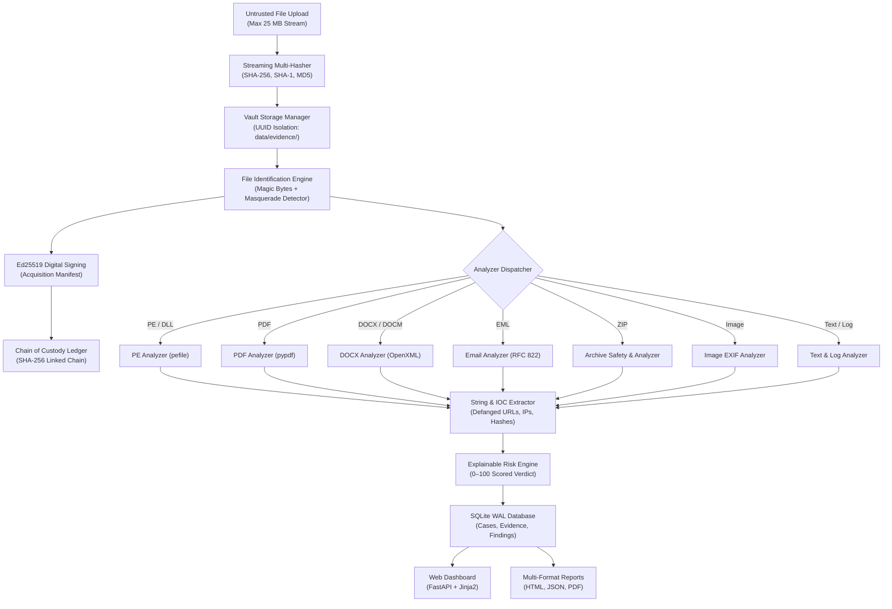

# ForenSight — Digital Forensics & Static Evidence Intelligence Platform

[](https://www.python.org/)
[](LICENSE)
[](tests/)
[](#security-architecture)
[](#installation--setup)

**ForenSight** is a high-assurance, local-first digital forensics and static malware triage platform engineered for incident responders, malware analysts, forensic examiners, and security engineers.

ForenSight delivers deep structural inspection of untrusted files, identifies extension masquerading, extracts defanged Indicators of Compromise (IOCs), calculates explainable risk scores, maintains a tamper-evident SHA-256 hash-chained custody ledger, and generates cryptographically signed (Ed25519) forensic examination reports in standalone HTML, JSON, and PDF formats.

---

## Key Capabilities

- **Strict Zero-Execution Guarantee**: Analyzes untrusted artifacts statically without ever invoking system loaders, script runtimes, macro engines, or shell interpreters.
- **Concurrent Multi-Hashing**: Computes NIST-standard SHA-256, SHA-1, and MD5 digests concurrently via 64 KB memory-bounded chunked streaming before files touch disk.
- **Pure-Python Identification**: Eliminates binary DLL / `libmagic.so` dependency conflicts across Windows and Kali Linux by pairing pure-Python byte identification (`puremagic`) with an internal forensic signature catalog.
- **Deception & Masquerade Detection**: Catches PE binaries disguised as PDFs, macro-enabled templates (`.docm`) disguised as clean `.docx`, double-extension payloads (`invoice.pdf.exe`), and suspicious file headers.
- **Deep Structural Forensic Analyzers**:
  - **Windows PE (EXE / DLL)**: DOS/NT/Optional headers, compile timestamp anomalies (zeroed / future timestomping), section entropy (UPX / packing detection), W^X memory section violations, high-risk API import catalogs (process hollowing, keylogging, anti-debug), Authenticode signatures, and overlay inspection.
  - **Adobe PDF**: Structural trailer/catalog parsing, active object hunting (`/JavaScript`, `/JS`, `/Launch`, `/OpenAction`, `/AA`, `/EmbeddedFiles`), and `/URI` hyperlink extraction.
  - **Office OpenXML (DOCX / DOCM)**: OpenXML package dissection, VBA macro storage detection (`vbaProject.bin`), embedded OLE compound objects, and Remote Template Injection hunting targeting external `.dotm` templates (MITRE ATT&CK T1221).
  - **RFC 822 Email (EML)**: Header anomaly analysis, spoof detection (mismatched `From` vs `Reply-To`), SPF/DKIM status inspection, body hyperlink extraction, and attachment hashing with dangerous executable extension alerts.
  - **Archives (ZIP)**: Zip Slip path traversal defense, zip-bomb / compression ratio explosion checks, nested archives, and double-extension executable alerts.
  - **Images (PNG / JPEG / TIFF)**: Pillow-based EXIF metadata extraction, camera manufacturer/model, original timestamps, and software tampering signatures (Photoshop, GIMP).
  - **Text & Incident Logs**: Bounded-line heuristic scanner hunting for ransomware volume shadow deletion (`vssadmin delete shadows`), encoded PowerShell commands (`powershell -enc`), dynamic execution (`IEX`), and Living-off-the-Land Binaries (LOLBins, e.g. `certutil -urlcache`).
- **Defanged IOC Intelligence**: Regex extraction engine capturing IPv4 (filtering loopback), IPv6, URLs, domains, registry keys, and file paths, automatically neutralized (e.g. `hxxp://`, `[.]`).
- **Explainable 0–100 Risk Engine**: Normalized transparent risk scoring capped by category to prevent heuristic inflation, providing clear rule contributions, confidence metrics, and standard forensic disclaimers.
- **Tamper-Evident Chain of Custody**: SHA-256 hash-chained immutable audit ledger recording every acquisition, integrity check, analysis run, and report export.
- **Cryptographic Verification (Ed25519)**: Ingestion manifests and examination reports are digitally signed using Ed25519 asymmetric cryptography.
- **Live Multi-Factor Integrity Audit**: Instant cryptographic verification validating file size, SHA-256, SHA-1, and MD5 against recorded evidence records.
- **Multi-Format Export**: Generates self-contained, offline-ready HTML reports (inlined CSS), structured JSON reports, and print-ready ReportLab PDF reports.
- **Local-First Web UI & REST API**: Forensic dark-themed dashboard built with FastAPI, Jinja2, vanilla CSS/JS (zero external CDNs or trackers), bound strictly to `127.0.0.1`.

---

## Architecture



---

## Security Architecture

1. **Localhost Binding**: FastAPI server binds strictly to `127.0.0.1` by default, eliminating unintended local network exposure.
2. **Defensive Storage Isolation**: Uploaded evidence is assigned a cryptographically random UUIDv4 and stored as `data/evidence/<uuid>.bin` outside any publicly served web routes.
3. **Path Traversal Protection**: Filenames undergo strict sanitization (null byte stripping, path separator elimination, reserved character neutralization). Archive analysis defends against Zip Slip traversal attacks.
4. **Resource Bounds**:
   - Default upload ceiling of 25 MB (`26,214,400` bytes), enforced during streaming with automatic deletion of partial files on violation.
   - String extraction capped at `5,000` strings (`4`–`256` chars, `10 MB` sample ceiling) and `50,000` max text lines in `Settings`.
   - Zip bomb defense enforcing maximum uncompressed size (`100 MB`), compression ratio (`100.0x`), recursion depth (`2`), and entry count ceiling (`500` entries).
5. **Read-Only Evidence Vault**: Stored files are set to read-only (`0o444`) on POSIX/Linux systems, complemented by live multi-hash verification.
6. **Key Protection**: Ed25519 private keys (`data/keys/`) are automatically excluded by `.gitignore` and generated with restricted filesystem permissions.

---

## Directory Structure

```
D:\Projects\ForenSight\
├── .env.example              # Configurable application defaults
├── .gitattributes            # Cross-platform LF line endings
├── .gitignore                # Excludes evidence, keys, reports, SQLite DBs
├── requirements.txt          # Production dependencies
├── requirements-dev.txt      # Development & testing dependencies
├── scripts/
│   └── generate_samples.py   # Safe synthetic demonstration specimen generator
├── data/
│   ├── evidence/             # Isolated UUID storage (git-ignored)
│   ├── keys/                 # Ed25519 keypair storage (git-ignored)
│   ├── reports/              # Generated PDF/HTML exports (git-ignored)
│   └── samples/              # Benign synthetic demonstration artifacts
├── forensight/
│   ├── __init__.py
│   ├── main.py               # FastAPI application factory & lifespan
│   ├── core/
│   │   ├── config.py         # Pydantic Settings configuration
│   │   ├── exceptions.py     # Forensics exception hierarchy
│   │   ├── security.py       # Path sanitization, Zip Slip check, defanging
│   │   └── types.py          # Unified data models & schemas
│   ├── storage/
│   │   ├── hasher.py         # Streaming SHA-256, SHA-1, MD5 hasher
│   │   └── manager.py        # Evidence vault & live integrity auditor
│   ├── ingestion/
│   │   ├── signatures.py     # Embedded forensic byte signature catalog
│   │   ├── identifier.py     # Pure-Python magic & masquerade engine
│   │   ├── archive_safety.py # Safe ZIP inspector (anti-zip-bomb/traversal)
│   │   └── pipeline.py       # Ingestion orchestrator & duplicate detector
│   ├── analyzers/
│   │   ├── base.py           # Abstract BaseAnalyzer interface
│   │   ├── pe_analyzer.py    # PE/DLL header, timestamp, packing, APIs
│   │   ├── pdf_analyzer.py   # PDF trailer, /JS, /Launch, /URI
│   │   ├── docx_analyzer.py  # DOCX/DOCM OpenXML, VBA macros, T1221 template
│   │   ├── email_analyzer.py # RFC 822 EML, spoof, SPF/DKIM, attachments
│   │   ├── archive_analyzer.py # ZIP structure, double extensions
│   │   ├── image_analyzer.py # EXIF metadata, camera, timestamps
│   │   └── text_analyzer.py  # Bounded logs, ransomware commands, LOLBins
│   ├── extraction/
│   │   ├── encoding.py       # UTF-8 / UTF-16 / ASCII encoding detector
│   │   └── strings.py        # Bounded ASCII & UTF-16LE string extractor
│   ├── intelligence/
│   │   ├── ioc_extractor.py  # Regex IOC engine with defanging
│   │   └── scoring.py        # Explainable 0–100 risk scoring engine
│   ├── crypto/
│   │   ├── keys.py           # Ed25519 keypair lifecycle manager
│   │   └── signing.py        # Manifest & report digital signature engine
│   ├── evidence/
│   │   ├── custody.py        # Tamper-evident SHA-256 hash-chained ledger
│   │   ├── correlation.py    # Case-level cross-evidence IOC correlation
│   │   └── timeline.py       # Unified forensic chronological timeline
│   ├── database/
│   │   ├── models.py         # SQLAlchemy ORM models (Cases, Evidence, Runs)
│   │   ├── session.py        # SQLite engine with WAL mode & foreign keys
│   │   └── crud.py           # Data access layer
│   ├── reports/
│   │   └── generator.py      # Standalone HTML, JSON, and ReportLab PDF reports
│   ├── api/
│   │   └── routes.py         # RESTful JSON endpoints (/api/v1)
│   └── dashboard/
│       ├── routes.py         # Jinja2 presentation endpoints
│       ├── static/           # Forensic dark theme CSS & vanilla JS
│       └── templates/        # Modular HTML templates
└── tests/                    # 80 automated unit & integration tests
```

---

## Installation & Setup

### Windows 11 (Development Environment)

```powershell
# 1. Clone repository
git clone https://github.com/YourUsername/ForenSight.git
cd ForenSight

# 2. Create and activate virtual environment
python -m venv venv
.\venv\Scripts\Activate.ps1

# 3. Install dependencies
pip install -r requirements.txt
pip install -r requirements-dev.txt

# 4. Generate synthetic demonstration evidence samples
python scripts/generate_samples.py

# 5. Run automated test suite
python -m pytest tests/ -v

# 6. Launch ForenSight application
uvicorn forensight.main:app --host 127.0.0.1 --port 8000 --reload
```

### Native Kali Linux (Execution & Testing Environment)

```bash
# 1. Clone or pull repository
git clone https://github.com/YourUsername/ForenSight.git
cd ForenSight

# 2. Create virtual environment
python3 -m venv venv
source venv/bin/activate

# 3. Install dependencies
pip install --upgrade pip
pip install -r requirements.txt
pip install -r requirements-dev.txt

# 4. Generate synthetic specimens (if not already present)
python3 scripts/generate_samples.py

# 5. Execute full test suite
python3 -m pytest tests/ -v

# 6. Launch application
uvicorn forensight.main:app --host 127.0.0.1 --port 8000
```

---

### Docker & Docker Compose (Containerized Orchestration)

ForenSight can be built and run in an isolated container with resource ceilings and loopback binding:

```bash
# 1. Build and start the containerized service
docker-compose up -d --build

# 2. View container health & logs
docker-compose logs -f

# 3. Stop the service
docker-compose down
```

The Docker deployment:
- Uses a multi-stage Debian-slim container running Python 3.13.
- Runs under a dedicated unprivileged user (`forensight`, UID 10001).
- Strictly binds to `127.0.0.1:8000` on the host (no network-wide exposure).
- Mounts a named volume (`forensight_vault_data`) to persist SQLite database, cryptographic keys, and the evidence vault.
- Drops all Linux kernel capabilities (`cap_drop: ALL`) and prevents privilege escalation (`no-new-privileges: true`).

---

Navigate to `http://127.0.0.1:8000` in your web browser.

---

## Synthetic Demonstration Specimens

A full battery of benign test files is generated by `scripts/generate_samples.py` into `data/samples/`:

| Specimen Filename | Format | Forensic Scenario Demonstrated |
| :--- | :--- | :--- |
| `sample_clean.exe` | PE32 | Clean, minimal valid 32-bit PE binary with valid section headers. |
| `sample_masquerade.pdf` | PE32 disguised as PDF | Deceptive extension masquerade (`IDENT-MASQ-001`). |
| `sample_actions.pdf` | PDF 1.7 | PDF containing active `/JavaScript`, `/Launch` actions, and `/URI` IOCs. |
| `sample_template_injection.docx` | OpenXML DOCX | Remote Template Injection referencing external `.dotm` (MITRE ATT&CK T1221). |
| `sample_phishing.eml` | RFC 822 EML | Header spoofing (`From` vs `Reply-To`), SPF fail, and `wire_transfer_receipt.pdf.exe` attachment. |
| `sample_double_extension.zip` | ZIP Archive | Archive containing disguised executable `statement.pdf.exe`. |
| `sample_ransomware_log.txt` | Text / Log | Command log with `vssadmin delete shadows`, encoded PowerShell, and LOLBins. |

---

## REST API Reference

| Method | Endpoint | Description |
| :--- | :--- | :--- |
| `GET` | `/api/v1/health` | Service health status and version probe. |
| `GET` | `/api/v1/dashboard/summary` | Global forensic metrics (total cases, evidence, severity counts). |
| `GET` | `/api/v1/cases` | List all investigation cases. |
| `POST` | `/api/v1/cases` | Create a new investigation case (`title`, `description`, `investigator`). |
| `GET` | `/api/v1/cases/{case_id}` | Case details with associated evidence items. |
| `PATCH` | `/api/v1/cases/{case_id}` | Update case workflow status (`OPEN`, `IN_PROGRESS`, `UNDER_REVIEW`, `CLOSED`), notes, tags, closure. |
| `POST` | `/api/v1/evidence/upload` | Upload untrusted artifact, compute multi-hashes, sign manifest, and triage. |
| `POST` | `/api/v1/evidence/{id}/verify` | Audit file digests, Ed25519 manifest signature, and persistent custody continuity. |
| `POST` | `/api/v1/verification/verify-all` | Run comprehensive vault verification across all cataloged artifacts. |
| `GET` | `/api/v1/findings` | Query findings filtered by severity, confidence, review status, rule, or analyzer. |
| `POST` | `/api/v1/findings/{id}/review` | Record analyst disposition (`OPEN`, `CONFIRMED`, `NEEDS_FOLLOWUP`, `FALSE_POSITIVE`) and notes. |
| `GET` | `/api/v1/timeline` | Retrieve unified multi-source UTC timeline (metadata, ingestion, analysis, custody, case activity). |
| `POST` | `/api/v1/reports/verify-manifest` | Verify an exported `EvidenceManifest` Ed25519 signature against active vault public key. |
| `GET` | `/evidence/{id}/export/html` | Download self-contained, escaped, offline-ready HTML forensic report. |
| `GET` | `/evidence/{id}/export/json` | Download full 16-section structured forensic triage JSON report. |
| `GET` | `/evidence/{id}/export/pdf` | Download print-ready ReportLab PDF examination report with Ed25519 signature block. |
| `GET` | `/evidence/{id}/export/csv` | Export forensic findings and rule/analyzer provenance as RFC 4180 CSV. |
| `GET` | `/evidence/{id}/export/stix` | Export extracted IOCs as a deterministic STIX 2.1 Threat Intelligence JSON bundle. |

---

## End-to-End Analyst Demonstration Workflow

1. Create a case dossier in `/cases` (`status = OPEN`).
2. Generate synthetic specimens (`python scripts/generate_samples.py`) and drag-and-drop `sample_template_injection.docx`, `sample_phishing.eml`, or `sample_ransomware_log.txt` into `/` or `/cases/{id}`.
3. Inspect pre-analysis digests (`SHA-256`, `SHA-1`, `MD5`), file identification, and masquerade alerts (`sample_masquerade.pdf`).
4. Review static findings, rule/analyzer versions, byte offsets, MITRE mappings, and record analyst dispositions in `/findings` or `/evidence/{id}`.
5. Inspect defanged IOCs (`hxxp://`, `[.]`) and cross-evidence correlations in `/cases/{id}`.
6. Inspect the multi-source UTC timeline (`original_timestamp` preserved alongside vault UTC events) in `/timeline`.
7. Audit hashes, Ed25519 manifest signature, and persistent custody chain in `/verification` (`INTEGRITY VERIFIED`).
8. Export HTML, JSON, PDF, Findings CSV, or STIX 2.1 IOC Bundle reports from `/evidence/{id}`.

---

## Automated Verification

ForenSight includes an automated test suite across 25 test modules (covering unit tests, analyzers, Phase 1 P0 fixes, Phase 3 intelligence centers, Phase 4 reporting, and Phase 5 adversarial/security regressions):

```bash
python scripts/verify_setup.py
python -m pytest tests/ -q
```

---

## Supported Formats & Known Limitations

| Format / Category | Analyzer | Static Inspection Capabilities | Known Limitations |
| :--- | :--- | :--- | :--- |
| **Windows PE (`EXE`, `DLL`, `SYS`)** | `PEAnalyzer` (`2.1.0`) | DOS/NT headers, PE32 vs PE32+, section entropy/permissions (W^X, zero raw size), bounded imports/exports/resources, CodeView debug PDB path, Authenticode table presence, overlay size. | Authenticode certificate presence does not perform OS trust-chain validation; heavily corrupted headers fall back to `PE-CORRUPT-001`. |
| **Adobe PDF** | `PDFAnalyzer` (`2.1.0`) | `/JavaScript`, `/JS`, `/OpenAction`, `/AA`, `/Launch`, `/EmbeddedFiles`, `/SubmitForm`, `/AcroForm`/`/XFA`, `/RichMedia`, `/ObjStm`, deduplicated `/URI` IOCs, metadata timestamps. | Raw scan bounded to 25 MB and 200 pages; encrypted PDF streams cannot inspect internal objects without decryption keys. |
| **OpenXML (`DOCX`, `DOCM`)** | `DocxAnalyzer` (`2.1.0`) | OpenXML `.rels` external URLs, remote template injection (`T1221`), VBA project presence (`vbaProject.bin`), embedded OLE parts, `docProps/core.xml` authorship & timestamps. | Macro presence indicates script capability only, not execution proof; XML parts capped at 2 MB per member; legacy binary `.doc` OLE2 falls back to string triage. |
| **RFC 822 Email (`EML`)** | `EmailAnalyzer` (`2.1.0`) | `From` / `Reply-To` / `Return-Path` inconsistencies, `Received` hops, `Authentication-Results` (SPF/DKIM/DMARC claims), MIME parts, attachment SHA-256 & extension risks, body URL/domain IOCs. | Authentication headers represent self-reported message claims (no DNS/DKIM key queries); binary Outlook `.msg` (OLE2) is not natively parsed and falls back to string triage. |
| **ZIP Archives** | `ArchiveAnalyzer` (`2.1.0`) | Zip-Slip traversal defense, zip-bomb bounds (`500` entries, `100 MB`, `100.0x`, depth `2`, `5s` budget), double extensions, executables, encrypted entries, bounded nested ZIP inspection. | Encrypted entries, RAR/7z/TAR containers cannot have internal members unpacked cleanly without external native decompressors. |
| **Images (`JPEG`, `PNG`, `GIF`)** | `ImageAnalyzer` (`2.1.0`) | EXIF tags, camera make/model, timestamps, editing software signatures, Pillow decompression-bomb guards. | Stripped metadata leaves only structural/entropy observations. |
| **Text / Logs / Unknown Binaries** | `TextAnalyzer` (`2.1.0`) | Bounded ASCII & UTF-16LE string extraction (`5,000` strings, `10 MB` sample), encoding confidence, command/LOLBin patterns with byte offsets, defanged IOC extraction. | Heuristic regex/keyword patterns do not replace full disassembly or dynamic sandboxing. |

---

## Boundaries & Disclaimer

- **TriageHound Boundary**: ForenSight is an independent file-centric static forensics platform. It is strictly separate from live-system incident response frameworks (e.g. TriageHound).
- **Academic & Forensic Disclaimer**: ForenSight provides heuristic static triage indicators. Risk scores reflect structural anomalies and potential threats; they do not constitute absolute confirmation of malware without dynamic behavioral confirmation.
- **Evidence Handling**: Never execute untrusted files outside safe, isolated forensic sandbox environments.

---

## License

This project is licensed under the MIT License. See [LICENSE](LICENSE) for details.

